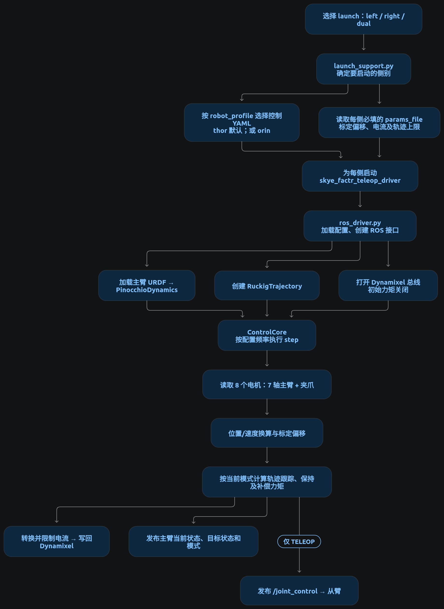
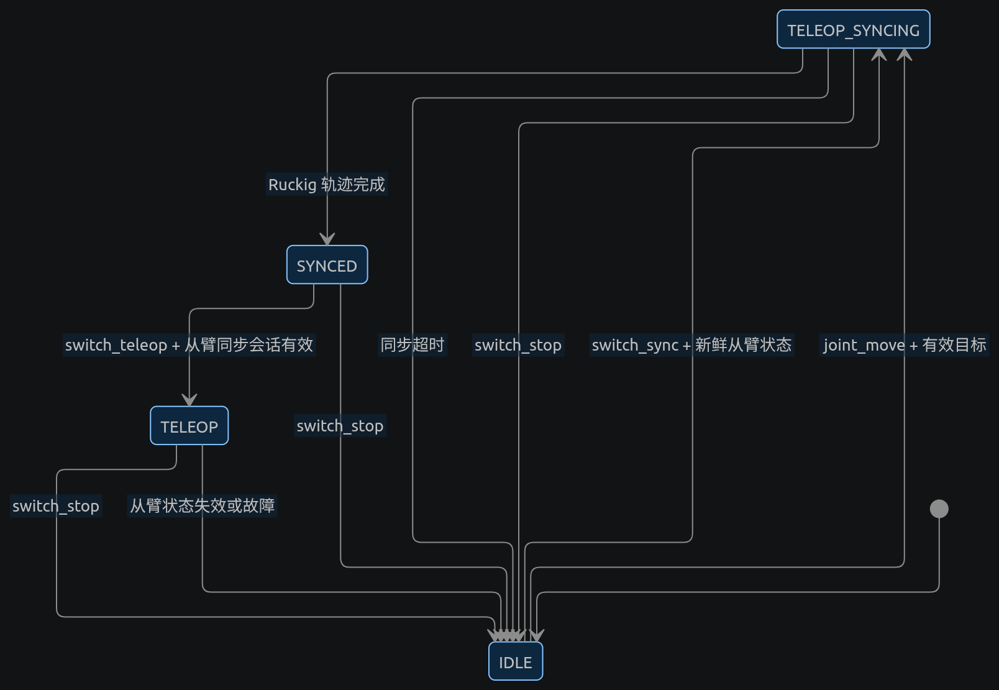

# Skye FACTR Teleop 启动与控制流程

从 `launch` 目录出发，项目的主线是：**选择主臂 → 加载配置并启动节点 → 周期性读取主臂、计算电流 → 根据模式决定是否向从臂发布控制指令**。

模式切换决定图中“轨迹跟踪、保持及遥操发布”何时生效：

几个关键接口关系：

- `left`、`right`、`dual` 三个入口分别启动 1、1、2 个同构主臂节点；启动文件**不负责启动从臂驱动**。[launch 入口](../launch/start_teleop_m6_dual.launch.py) · [节点构造与重映射](../skye_factr_teleop/launch_support.py)
- 每侧从 `/gento/<side>_joint_states` 接收从臂反馈；只有进入 `TELEOP` 后，才向 `/gento/<side>_joint_control` 发布主臂的 7 轴位置。`/mode/switch_*` 和 `/teleop/state` 是双臂共用的话题名。[ROS 接口与发布条件](../skye_factr_teleop/ros_driver.py)
- `joint_move` 可以让主臂独立走位并进入 `SYNCED`，但不会建立从臂同步会话，因此不能直接据此进入遥操。[命令处理](../skye_factr_teleop/ros_driver.py)
- 控制周期中，`ControlCore` 汇总关节限位、重力、静摩擦、零空间和轨迹跟踪力矩，再换算为受限电流；其中各项是否启用由配置和模式决定。[控制循环](../skye_factr_teleop/control_core.py) · [左臂控制配置](../config/grav_comp_m6_left.yaml)
