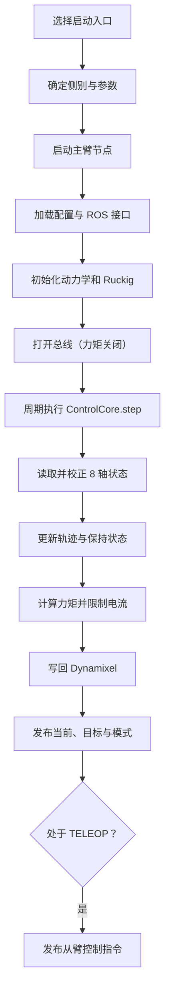
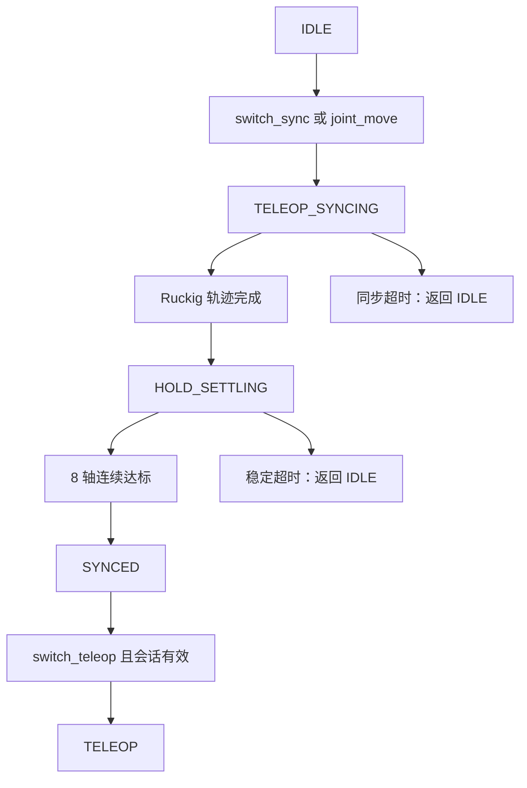

# Skye FACTR Teleop 启动与控制流程

从 `launch` 目录出发，项目的主线是：**选择主臂 → 加载配置并启动节点 → 周期性读取主臂、推进同步/保持状态并计算电流 → 根据模式决定是否向从臂发布控制指令**。

模式切换决定图中“轨迹跟踪、保持及遥操发布”何时生效：

`switch_sync` 要求新鲜的从臂状态，`joint_move` 要求有效目标。同步时，`TELEOP_SYNCING` 跟踪 Ruckig 轨迹；轨迹完成只表示规划运动结束，随后进入 `HOLD_SETTLING` 并保持同步目标。主臂 8 个轴的**实测**位置误差和速度须同时处于各自阈值内，并连续保持 `settle_duration`，才进入 `SYNCED`。任一轴超出阈值会重新计时；`settle_timeout` 到期则停止并回到 `IDLE`。`switch_teleop` 仅在 `SYNCED` 且从臂同步会话有效时生效。任一模式收到 `switch_stop` 都会回到 `IDLE`；遥操中从臂状态失效或发生故障也会停止。[状态转换](../../skye_factr_teleop/state_machine.py) · [判定与保持控制](../../skye_factr_teleop/control_core.py) · [阈值配置](../../config/grav_comp_m6_left.yaml)

几个关键接口关系：

- `left`、`right`、`dual` 三个入口分别启动 1、1、2 个同构主臂节点；启动文件**不负责启动从臂驱动**。[launch 入口](../../launch/start_teleop_m6_dual.launch.py) · [节点构造与重映射](../../skye_factr_teleop/launch_support.py)
- 每侧从 `/gento/<side>_joint_states` 接收从臂反馈；只有进入 `TELEOP` 后，才向 `/gento/<side>_joint_control` 发布主臂的 7 轴位置。`/mode/switch_*` 和 `/teleop/state` 是双臂共用的话题名。[ROS 接口与发布条件](../../skye_factr_teleop/ros_driver.py)
- `joint_move` 同样经过 `TELEOP_SYNCING → HOLD_SETTLING → SYNCED`，但不会建立从臂同步会话，因此不能直接据此进入遥操。[命令处理](../../skye_factr_teleop/ros_driver.py)
- 控制周期中，`ControlCore` 汇总关节限位、重力、静摩擦、零空间和轨迹跟踪力矩，再换算为受限电流；其中各项是否启用由配置和模式决定。[控制循环](../../skye_factr_teleop/control_core.py) · [左臂控制配置](../../config/grav_comp_m6_left.yaml)
